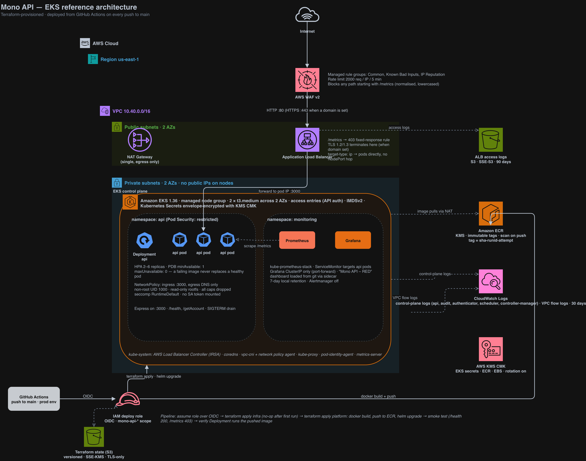
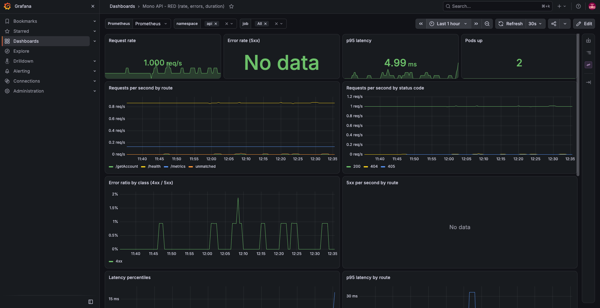

# Solution: Mono DevOps assessment

The assessment API running on EKS behind an ALB, provisioned with Terraform
and deployed from GitHub Actions on every push to `main`.

| Requirement | Where |
|---|---|
| 1. Dockerfile | `Dockerfile` |
| 2. EKS with Terraform | `terraform/infra` |
| 3. Image built and pushed to ECR by Terraform | `terraform/platform/image.tf` |
| 4. Deploy from ECR to the cluster | `terraform/platform/app.tf`, `charts/api` |
| 5. CI/CD on push to the default branch | `.github/workflows/deploy.yml` |
| 6. Public, secure, available | ALB and WAF, private nodes, HPA and PDB, two AZs |
| Bonus 1. Prometheus scrapes `/metrics` | `terraform/platform/monitoring.tf`, `ServiceMonitor` in the chart |
| Bonus 2. Zero-downtime upgrade plan | `docs/eks-upgrade-plan.md` |
| Bonus 3. Extended metrics and Grafana dashboard | `src/services/metrics.service.ts`, `dashboards/api-red.json` ([screenshot](docs/images/grafana-dashboard.png)) |
| Bonus 4. Live URL | last section |

## Architecture



Editable source: `docs/architecture.drawio` (open at app.diagrams.net).

A request passes through WAF, then the ALB, then straight to a pod IP
(`target-type: ip`, no NodePort hop) and into Express on port 3000. TLS
terminates at the ALB when a domain is configured. `/metrics` is answered with
a 403 at the edge and never reaches a pod from the internet.

A deploy starts with a push to `main`. The workflow assumes the deploy role
over OIDC, applies `infra` (a no-op after the first run), then applies
`platform`, which builds the image on the runner, pushes it to ECR and
upgrades the Helm release. It ends with a smoke test against the live URL
(`/health` is 200, `/metrics` is 403 in four spellings) and a check that the
Deployment is running the image that was just pushed.

### Terraform layout

```
terraform/
├── bootstrap/   applied once by hand: state bucket, GitHub OIDC provider,
│                two IAM roles (plan: read-only; deploy: scoped)
├── infra/       VPC and flow logs, KMS key, EKS, ECR, ALB-controller IRSA role,
│                WAF, ALB log bucket, optional ACM certificate
└── platform/    docker build and ECR push, ALB controller, kube-prometheus-stack,
                 dashboard ConfigMap, the api Helm release
```

## How to run it

Prerequisites: AWS credentials in the shell, `terraform >= 1.10`, `docker`,
`helm`, `kubectl`, and `gh` for the Makefile to look up the repo.

### Bootstrap (once, about 2 minutes)

```bash
export AWS_PROFILE=<profile> AWS_REGION=us-east-1
make bootstrap GITHUB_REPO=<owner>/<repo>
```

Then in the GitHub repo:

* Variables: `AWS_DEPLOY_ROLE_ARN`, `AWS_PLAN_ROLE_ARN`, `TF_STATE_BUCKET`
  (the bootstrap outputs); `CLUSTER_ADMIN_ARNS` (JSON list of IAM ARNs that
  get `kubectl` access, since CI creates the cluster); optionally
  `AWS_REGION` (default `us-east-1`), `API_DOMAIN_NAME` and
  `ROUTE53_ZONE_ID`.
* Secret `GRAFANA_ADMIN_PASSWORD`, optional. Without it the chart generates
  one and `make grafana` prints it.
* A `prod` environment, restricted to the `main` branch. Adding a required
  reviewer turns the deploy into an approval gate.

### Deploy

Push to `main`, or locally:

```bash
make deploy          # infra (about 15 min for EKS), then platform (about 8 min)
make kubeconfig
terraform -chdir=terraform/platform output api_url
```

### Verify

```bash
URL=$(terraform -chdir=terraform/platform output -raw api_url)
curl $URL/health
curl "$URL/getAccount?id=66ab443c4d4ac0b1cdf456911"
curl -i $URL/metrics          # 403
make grafana                  # http://localhost:3001, dashboard "Mono API - RED"
```

### Tear down

```bash
make destroy         # platform first (releases the ALB), then infra
# or: Actions -> Destroy -> type mono-api-prod
```

The bootstrap resources stay. `terraform -chdir=terraform/bootstrap destroy`
removes them.

### Local development

```bash
npm ci && npm run dev                 # watch mode on :3000
make build && make run                # the production image
```

## Decisions and trade-offs

**Three Terraform stacks, not one.** The Kubernetes and Helm providers need a
live cluster endpoint at plan time. A single root module that creates the
cluster and installs Helm releases works on the first apply and fails on
destroy and on any plan that replaces the cluster. The deploy workflow still
runs the whole chain on each push, so it behaves as one pipeline.

**Image built by Terraform** through the `kreuzwerker/docker` provider, as
requirement 3 asks. The image, its tag and the Helm release are in one state,
so a plan shows which image a rollout will ship. The build runs wherever
`terraform apply` runs, so the runner needs Docker and the Dockerfile has to
stay within what the classic builder supports. ECR tags are immutable, so the
tag is `<short sha>-<run id>-<attempt>`: a re-run of the same commit gets a
new tag instead of failing on push. `null_resource` with `local-exec` was
rejected because it gives no diff and no drift detection.

**Helm chart** rather than raw manifests, with values injected by Terraform.
`image.repository` and `image.tag` are `required`, so `latest` cannot be
deployed by accident.

**ALB with WAF** rather than an NLB or ingress-nginx. The ALB terminates TLS,
supports per-path rules (how the `/metrics` block works), attaches to WAF and
writes access logs. ingress-nginx would add a hop and a component to patch.
API Gateway charges per request and is more than four GET endpoints need.
CloudFront adds nothing for an uncacheable, single-region API and is listed in
the gaps for a global audience.

**Two on-demand `t3.medium` nodes across two AZs.** Two nodes is the minimum
that lets a PDB of `minAvailable: 1` coexist with a node drain. Smaller
instance types hit the ENI pod limit once the ALB controller and Prometheus
are on the cluster. Fargate has no DaemonSets and cannot run node-exporter.
Karpenter is the right answer at scale and a second component to run for a
two-node cluster.

**One NAT gateway.** Saves about $32 a month. If its AZ fails the other AZ
loses egress, and this app has no outbound dependencies beyond ECR pulls at
pod start and DNS. `single_nat_gateway = false` switches to per-AZ NAT.

**EKS API endpoint public but allow-listed.** `endpoint_public_access_cidrs`
defaults to open so the assessment is reproducible. In a real account it would
be the office or VPN range plus the CI runner egress, or private only with a
bastion.

**`/metrics` blocked at the edge**, not in the app, so the app behaves the
same in every environment. Two layers: a WAF rule that lowercases and
normalises the path and blocks anything starting with `/metrics`, and an ALB
fixed-response rule on the `/metrics` prefix. Prometheus scrapes the pods
inside the VPC and never crosses the ALB.

**Access entries** (`authentication_mode = "API"`) instead of the `aws-auth`
ConfigMap, so every grant of cluster access is an IAM-auditable call. The
identity that runs the first apply becomes admin; `CLUSTER_ADMIN_ARNS` adds
the people who need `kubectl`.

**kube-prometheus-stack** rather than Grafana Alloy with Amazon Managed
Prometheus. One release provides Prometheus, Grafana, the operator and the
`ServiceMonitor` CRD, and the dashboard is loaded from git through the sidecar
so it is reviewed in a PR. Alertmanager is off to keep the footprint small.
Managed Prometheus and Grafana are in the gaps.

**OIDC for CI, no access keys.** `plan` (ReadOnly plus state access) can be
assumed from pull requests; `deploy` only from `main` and the `prod`
environment. The deploy role is PowerUser plus an IAM grant limited to
resources prefixed `mono-api-*`, so Terraform can create the cluster, node
and IRSA roles and nothing else in the account.

### Code changes to the service

Three small changes so the service runs well on Kubernetes, and one
dependency fix:

* `src/server.ts`: SIGTERM and SIGINT handler that stops accepting
  connections, drains in-flight requests and exits. `docker stop` now returns
  in under a second instead of after the kill timeout. Keep-alive timeout
  raised above the ALB idle timeout to avoid 502s on connection reuse.
* `src/services/metrics.service.ts`: `http_request_duration_seconds`
  histogram and `http_requests_in_flight` gauge. The `route` label is
  normalised so unknown paths collapse to `unmatched`; the original used the
  raw path, which let any scanner create one time series per URL.
* `src/middleware/request-metrics.middleware.ts`: times each request and
  records on the response `close` event, so a client that disconnects
  mid-response still decrements the in-flight gauge (status `499`).
* `package.json`: `overrides` pins `multer` to 2.x. routing-controllers only
  loads it for upload decorators this API does not use, and 1.x carried ten
  HIGH CVEs that fail the Trivy gate. The runtime image also removes npm,
  whose bundled `undici` and `brace-expansion` were flagged.

Observed and left alone: all three dummy accounts share the same `id`, so
`/getAccount?id=` can only return the first. That is application data, not
infrastructure.

## Security and compliance

| Concern | Implementation |
|---|---|
| Least-privilege IAM | No long-lived keys. GitHub to AWS via OIDC with branch- and environment-scoped trust. Deploy role limited to `mono-api-*` IAM resources, `PassRole` only to EKS, EC2, Pod Identity and flow logs. ALB controller via IRSA with the vendor policy. Pods do not mount service account tokens. IMDSv2 with hop limit 1, so a pod cannot reach the node's instance role. |
| Secrets | Kubernetes Secrets envelope-encrypted with a customer-managed KMS key, rotation on. The app has no secrets today; the path when it does is External Secrets Operator with Secrets Manager via IRSA. |
| Encryption in transit | TLS 1.2/1.3 at the ALB (`ELBSecurityPolicy-TLS13-1-2-2021-06`) with HTTP to HTTPS redirect when a domain is set. ALB to pod is plain HTTP inside private subnets; mTLS is in the gaps. State bucket is TLS-only. |
| Encryption at rest | KMS key for EKS secrets, ECR images and node EBS volumes. State bucket SSE-KMS. ALB logs SSE-S3, the only mode ALB delivery supports. |
| Network | Nodes in private subnets with no public IPs. Node security group accepts the app port from inside the VPC only. `NetworkPolicy` limits pod ingress to the app port and egress to DNS, enforced by the VPC CNI network policy agent. The `api` namespace enforces Pod Security `restricted`. |
| Edge | WAF managed rule groups (Common, Known Bad Inputs, IP Reputation), a 2000 requests per IP per 5 minutes rate limit, and the `/metrics` path block. ALB drops invalid headers. Only GET is implemented; other methods get 405. |
| Supply chain | Immutable ECR tags, scan on push, tag carries the commit sha, Trivy gate in CI on fixable HIGH and CRITICAL, `npm ci` from the lockfile, pinned actions, providers, modules and charts. |
| Audit logging | EKS control-plane logs (api, audit, authenticator, controllerManager, scheduler) to CloudWatch, 30 days. VPC flow logs. ALB access logs to S3, 90 days. WAF sampled requests. Terraform state versioned, so every change has a before and after. |
| Runtime hardening | Non-root UID 1000, read-only root filesystem, all capabilities dropped, `seccompProfile: RuntimeDefault`, no privilege escalation, memory limits. `monitoring` warns rather than enforces, because node-exporter needs host network and PID access. |

### Control mapping

| Control | ISO 27001:2022 | PCI DSS v4.0 | Evidence from this setup |
|---|---|---|---|
| Access control, least privilege | A.5.15, A.5.18, A.8.2 | 7.2, 7.3, 8.3 | OIDC trust policies, scoped deploy role, access entries, IRSA |
| Cryptography | A.8.24 | 3.5, 4.2 | KMS key with rotation, TLS policy on the ALB, encrypted EBS, ECR and S3 |
| Network security | A.8.20, A.8.21, A.8.22 | 1.2, 1.3, 1.4 | Private subnets, security groups, NetworkPolicy, WAF |
| Logging and monitoring | A.8.15, A.8.16 | 10.2, 10.3, 10.4 | EKS audit logs, flow logs, ALB logs, Prometheus and Grafana |
| Secure configuration | A.8.9 | 2.2 | Everything in Terraform and Helm; CI runs `fmt`, `validate`, `lint` |
| Vulnerability management | A.8.8 | 6.3, 11.3 | ECR scan on push, Trivy in CI |
| Change management | A.8.32 | 6.5 | Plan comments on PRs, branch-gated deploy role, `prod` environment |
| Secure development | A.8.25, A.8.28 | 6.2 | Lockfile, typecheck, non-root image, no secrets in the repo |
| Backup and continuity | A.8.13, A.8.14 | 12.10 | Versioned state, ECR retention, two AZs |

Not covered, and required for a real PCI scope: the API returns account
numbers and balances with no authentication, because the brief defines it as
a public read-only API. Production would need authentication on the
endpoints, controls so account numbers never land in ALB logs through query
strings, quarterly ASV scans, and a documented key-management procedure.

## Backup and recovery

The service is stateless; the "database" is an in-memory array. What matters
is the infrastructure definition (git), the Terraform state (versioned S3),
the images (ECR, last 20 tags) and the cluster configuration (reproducible
from Terraform).

| Scenario | RTO | RPO | How it is met |
|---|---|---|---|
| Pod or node failure | seconds | 0 | two or more replicas, HPA, PDB, spread across AZs; the ALB drops an unhealthy target within 30 s |
| AZ failure | under 1 min | 0 | nodes and ALB in two AZs; the HPA back-fills. The single NAT is the known weak point, for egress only |
| Bad deploy | under 5 min | 0 | `maxUnavailable: 0` means a failing image never replaces a healthy pod; redeploy the previous tag to roll back |
| Cluster or region loss | about 30 min | 0 | `make deploy` into a fresh account or region from git and state; ECR can be replicated cross-region with one resource |
| State corruption | under 10 min | last apply | restore the previous S3 object version |

If the application gained real state, for example accounts in RDS: Multi-AZ
with automated backups and point-in-time recovery (RPO about 5 minutes, RTO
about 10 for an instance failure), a cross-region read replica for regional
DR, and Velero for anything persisted in-cluster.

## Gaps

In the order I would address them.

1. Authentication on the API. `/getAccount` returns account numbers; the
   brief specifies a public read-only API. Production needs OAuth2 or JWT at
   the ALB or in the app.
2. A real domain and TLS. `domain_name` and `route53_zone_id` produce an ACM
   certificate, an HTTPS listener with redirect and a Route53 alias. No
   domain was available for this submission, so the path is validated but
   not exercised and the live URL is plain HTTP.
3. A staging environment: the same modules with a second `tfvars` and state
   key, and the `prod` deploy gated on a staging smoke test.
4. Alerting. Prometheus rules for error rate, p95 latency and unavailable
   pods, with Alertmanager routed to PagerDuty or Slack. The dashboard shows
   problems; nobody is paged.
5. Durable observability. Prometheus has 7-day local retention; move to
   Amazon Managed Prometheus and Grafana, ship logs with Fluent Bit, add
   tracing once there is more than one service.
6. Node autoscaling. The HPA scales pods; nothing scales nodes. Karpenter.
7. Policy as code: Kyverno or Gatekeeper in the cluster, `tflint` and
   `checkov` in CI.
8. Production safety switches turned off for easy teardown: per-AZ NAT, ALB
   deletion protection, `force_delete = false` on ECR, `prevent_destroy` on
   the state bucket.
9. Committed provider lock files with hashes for both Linux and macOS
   (`terraform providers lock -platform=...`), and GitHub Actions pinned to
   commit SHAs with Dependabot keeping them current.
10. Incident, rollback and key-rotation runbooks alongside the upgrade one.

## How AI was used

I used AI as a coding and debugging assistant.

It produced first drafts of the multi-stage Dockerfile, the Helm chart, the
three Terraform stacks, the GitHub Actions workflows and the Grafana
dashboard JSON from written specifications for each piece. It also looked
up current versions of the EKS module, providers and charts so the version
pins were correct.

Every draft was reviewed and corrected before use. The first chart lost
`.Values` scope inside a `range`, a module argument had the wrong name, the
ALB controller chart pin was a major version behind, and the Kubernetes 3.x
provider needed `exec` as a block.

It ran the local checks on request: typecheck, helm lint and template,
terraform validate and the container smoke tests.

During deployment against the real AWS account it was used to narrow down
failures from the error output and context. The issues found this way were
GitHub's immutable OIDC subject claims, the environment subject on the
deploy job, a service-linked-role lookup the deploy role could not make,
node-exporter under the baseline Pod Security profile, and the ALB
controller's rule ordering.

## Live URL

http://k8s-monoapiprod-f1ecaa2ed8-1922037777.us-east-1.elb.amazonaws.com

```bash
curl http://k8s-monoapiprod-f1ecaa2ed8-1922037777.us-east-1.elb.amazonaws.com/health
curl "http://k8s-monoapiprod-f1ecaa2ed8-1922037777.us-east-1.elb.amazonaws.com/getAccount?id=66ab443c4d4ac0b1cdf456911"
curl -i http://k8s-monoapiprod-f1ecaa2ed8-1922037777.us-east-1.elb.amazonaws.com/metrics   # 403
```

Plain HTTP on the ALB hostname because no domain was available. The URL is an
output of the platform stack and the deploy workflow prints it on every run.
If the environment has been torn down by the time you read this,
`make deploy` brings it back in about 25 minutes with a new hostname.

Grafana is not exposed. `make grafana` prints the admin password and
port-forwards it to http://localhost:3001. The dashboard as it looked with
live traffic:


